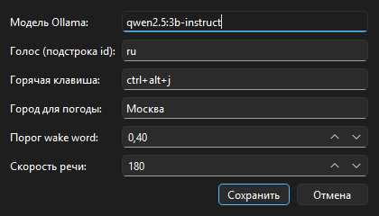

# Джарвис — локальный голосовой ассистент для Windows

Личный проект — локальный голосовой ассистент для Windows.
Ассистент слушает микрофон, распознаёт русскую речь, отвечает голосом, выполняет
команды управления ПК и ведёт диалог с локальной языковой моделью через Ollama.
Обязательная часть работает **полностью офлайн**, без API-ключей и аккаунтов.



## Быстрый старт (Windows 10/11, Python 3.10)

```powershell
python -m venv .venv
.venv\Scripts\python.exe -m pip install --upgrade pip
.venv\Scripts\python.exe -m pip install -r requirements.txt
ollama pull qwen2.5:3b-instruct
.venv\Scripts\python.exe scripts\download_models.py
.venv\Scripts\python.exe -m jarvis
```

Первые два скачивания большие: модель Whisper small (~480 МБ) и модель wake word
`hey_jarvis` (~5 МБ). Их нужно скачать заранее, чтобы демонстрация шла офлайн.
Подробности — в [docs/user-guide.md](docs/user-guide.md).

## Что умеет

| Область | Команды (примеры) |
|---|---|
| Консоль | Rich-баннер, цветной статус «Слушаю…», спиннер «Думаю…», таблица команд, `help`/`команды` |
| Активация | Кнопка «Говорить» / `Ctrl+Alt+Space`, «Хей, Джарвис» или `Ctrl+Alt+J` |
| Программы | «открой дискорд», «запусти блокнот», «открой хром», «открой загрузки» |
| Обновление списка ПО | «обнови список программ» |
| Погода | «какая погода в Москве» (Open-Meteo, кэш 10 минут) |
| Таймеры | «таймер на 5 минут», «напомни через час позвонить маме» |
| Громкость | «громкость 30», «сделай громче», «выключи звук» |
| Время и дата | «который час», «какое сегодня число» |
| Скриншот | «сделай скриншот» → `data/screenshots/` |
| Поиск | «найди в интернете рецепт борща», «включи на ютубе джаз» |
| Заметки | «запиши заметку купить хлеб», «что у меня на сегодня» |
| Питание | «заблокируй компьютер», «выключи компьютер» (с подтверждением) |
| Чат с LLM | любой вопрос: «объясни, что такое инкапсуляция» |
| Стоп | «стоп», «хватит», «заверши работу» |
| Shell | опционально, выключен по умолчанию, белый/чёрный список, подтверждение |

Маршрутизация гибридная: сначала быстрые офлайн-правила (regex + RapidFuzz + слоты),
затем function calling локальной модели, затем обычный чат. Ответы модели озвучиваются
по предложениям, контекст — последние 12 реплик.

## Режимы запуска

```powershell
.venv\Scripts\python.exe -m jarvis              # текст + голос (если есть микрофон)
.venv\Scripts\python.exe -m jarvis --text       # только текст, без микрофона
.venv\Scripts\python.exe -m jarvis --tray       # трей и окно с кнопкой «Говорить»
.venv\Scripts\python.exe -m jarvis --once "который час" --no-greeting
```

В консоли команды можно вводить текстом — это удобно для отладки и проверки без микрофона.
Таблица зарегистрированных навыков выводится при старте; повторить её можно командами
`help` или `команды`. Выход: `q`, `quit`, `exit`, «выход» или `Ctrl+C`; голосом — «заверши работу».

Для push-to-talk запустите `--tray`: в окне «Пульт микрофона» нажмите
**«Говорить»**, задайте вопрос и нажмите **«Остановить»** — ответ появится после
остановки записи. Та же функция доступна по `Ctrl+Alt+Space`. Если wake word
мешает (ложные срабатывания на шум), отключите его в настройках — останутся
кнопка и горячая клавиша.

## Проверка железа

```powershell
.venv\Scripts\python.exe scripts\wakeword_check.py   # устройства, score, порог
.venv\Scripts\python.exe scripts\tts_check.py        # список голосов и русская фраза
```

## Архитектура

Слои: `presentation` (`ui/`), `application` (`core/`), `domain` (`core/models.py`),
`infrastructure` (`audio/`, `providers/`, `os_win/`, `storage/`, `config.py`).
Ядро не знает о Windows: низкоуровневые вызовы собраны в `os_win/` и
навыках-адаптерах, а `core/` не импортирует Windows API.
Подробно: [docs/architecture.md](docs/architecture.md), UML — [docs/uml](docs/uml).

```
src/jarvis/
  core/        assistant.py fsm.py router.py events.py registry.py models.py
  audio/       capture.py vad.py wakeword.py loop.py playback.py
  providers/   stt/whisper.py tts/sapi5_tts.py tts/pyttsx3_tts.py llm/ollama.py
  skills/      app_launcher weather timer volume time_date screenshot
               search_web notes system shell control chat
  os_win/      apps_index.py uwp.py aliases.py
  storage/     db.py repositories.py
  ui/          console.py tray.py control_window.py settings_window.py hotkeys.py
```

## Документация

- [Требования](docs/requirements.md) — FR/NFR, MoSCoW, use cases, глоссарий.
- [Архитектура](docs/architecture.md) — C4, слои, паттерны, потоки данных.
- [UML-диаграммы](docs/uml) — use case, компоненты, классы, последовательности,
  состояния, деятельность, развёртывание, ER.
- [ADR](docs/adr) — STT, TTS, wake word, LLM, GUI, хранилище.
- [Тестирование](docs/testing.md) — пирамида, моки, ручной чек-лист, замеры.
- [Руководство пользователя](docs/user-guide.md) — установка и troubleshooting.
- [Разработка навыков](docs/skill-dev-guide.md) — новый навык за 10 минут.
- [Итоговый отчёт](docs/report.md) — этапы P0–P6, метрики и ограничения.

## Качество

```powershell
.venv\Scripts\python.exe -m ruff check .
.venv\Scripts\python.exe -m mypy src
.venv\Scripts\python.exe -m pytest -q --cov=jarvis.core --cov-report=term-missing
```

Текущее состояние: 78 тестов, покрытие `jarvis.core` — 92 %, ruff и mypy без ошибок.
Тесты не требуют микрофона, колонок и сети.

## Известные ограничения

- Wake word `hey_jarvis` обучен на английской речи: на демо лучше говорить «хей, Джарвис»
  с английским произношением. Порог настраивается в `config/config.toml`.
  При ложных срабатываниях на шум используйте кнопку «Говорить» или
  `Ctrl+Alt+Space`, а wake word отключите в настройках.
- Push-to-talk записывает до повторного нажатия; аварийный лимит — 60 секунд.
  Если запись короче ~0,3 с, ассистент попросит повторить, не отправляя её в LLM.
- Barge-in не реализован: во время синтеза речи микрофон приостанавливается, поэтому
  перебить ассистента голосом нельзя. «Стоп» работает, когда ассистент молчит;
  горячая клавиша доступна всегда.
- `edge-tts` — опциональный онлайн-режим (`pip install ".[edge]"`), по умолчанию
  используется офлайн-Windows SAPI5 (`sapi5_tts.py`); `pyttsx3` оставлен как
  резервный провайдер. Без русского речевого пакета Windows голос будет
  английским (в лог пишется предупреждение).
- Погода и веб-поиск требуют интернета; без сети ассистент корректно отказывает,
  остальные функции продолжают работать.
- Запуск UWP-приложений зависит от `Get-StartApps` и `explorer.exe shell:AppsFolder`;
  некоторые приложения Store могут не реагировать. Discord запускается через
  `discord://` или `Update.exe --processStart Discord.exe` без хардкода версии.
- Сложные действия внутри приложений (зайти в канал Discord, отправить сообщение)
  в обязательный объём не входят.
- GUI: смена обеих горячих клавиш применяется сразу, если голосовой цикл запущен;
  иначе — после перезапуска. Окно настроек сохраняет `config/config.toml`.
- Shell-навык по умолчанию выключен; разрешён только белый список безопасных команд.
- Whisper small может ошибаться в редких именах; названия программ лечатся алиасами
  в конфиге и нечётким поиском по меню «Пуск».
