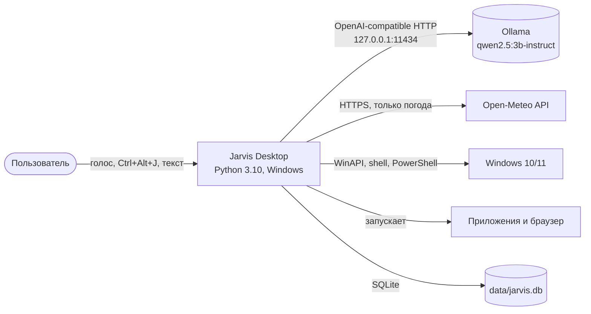
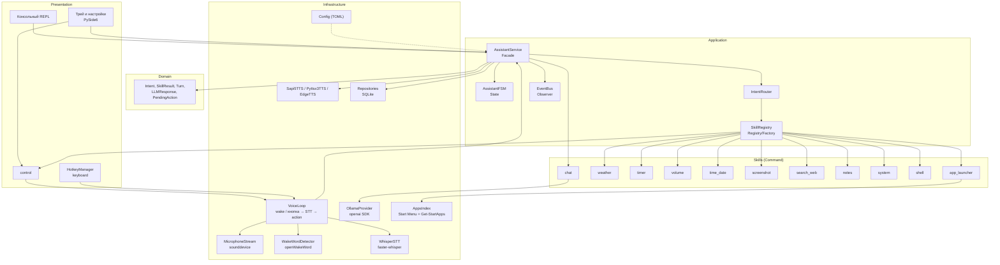
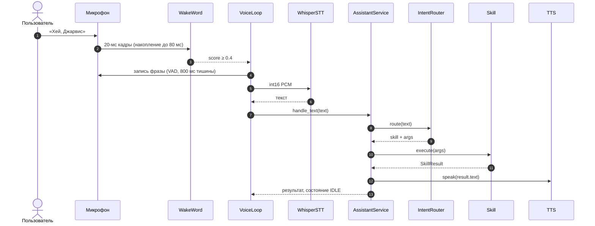
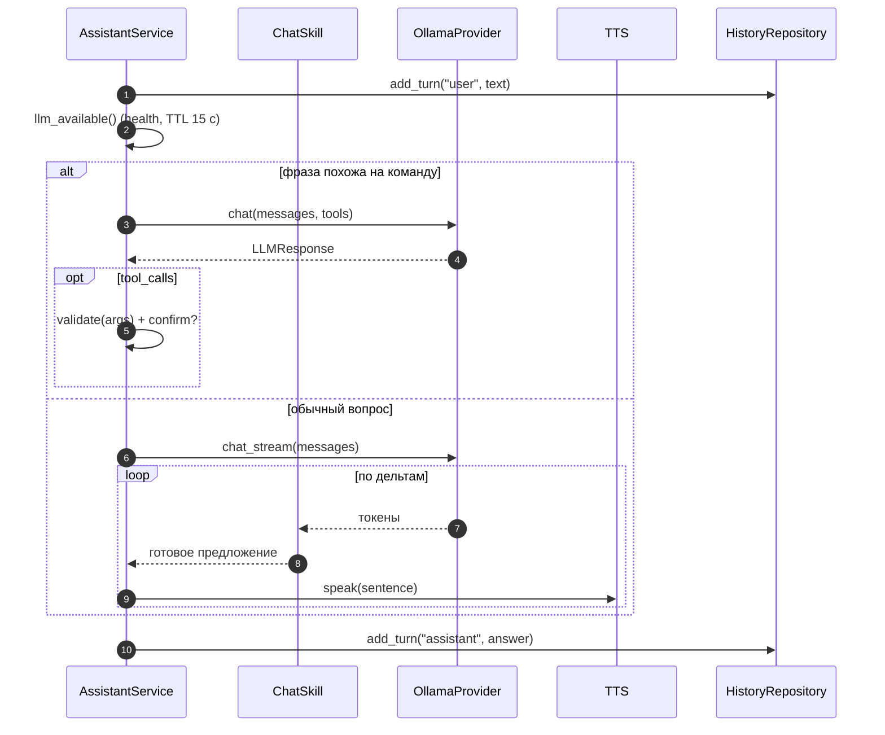
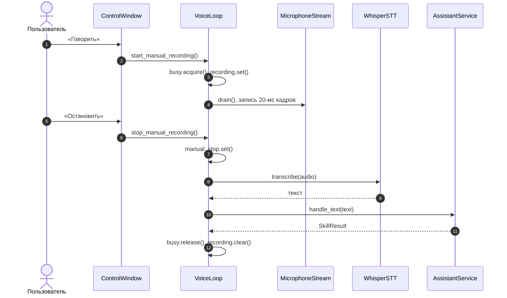
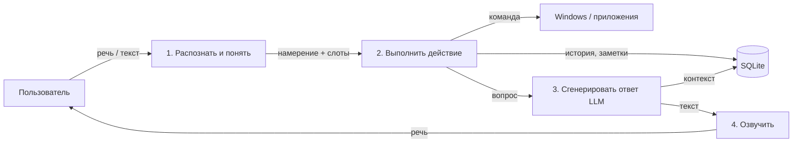

# Архитектура «Джарвиса»

Документ описывает архитектуру по C4 (уровни 1–2), слои, потоки данных,
применённые паттерны и модель конкурентности. Диаграммы Mermaid находятся в
[`docs/uml`](uml) и соответствуют фактическому коду.

## 1. Принципы

1. **Слоистость.** Направление зависимостей — только внутрь:
   `presentation → application → domain ← infrastructure`.
   Ядро (`core/`) не импортирует Windows-модули и конкретные провайдеры.
2. **Внедрение зависимостей.** Никаких глобальных синглтонов: все компоненты
   получают настройки и коллабораторов через конструктор (`app.py` — композиционный
   корень).
3. **Контракты вместо реализаций.** STT, TTS и LLM описаны `Protocol`-интерфейсами,
   конкретные адаптеры выбираются в `config.toml` (Strategy).
4. **Изоляция ОС.** Низкоуровневые вызовы собраны в `os_win/` (UWP,
   `shutdown`, `ctypes.windll`, `Get-StartApps`), а специализированные адаптеры
   навыков (`volume`, `screenshot`, `shell`) инкапсулируют pycaw, pyautogui и
   `subprocess`. Ядро (`core/`) не импортирует Windows API.
5. **Отказоустойчивость.** Любой внешний вызов имеет таймаут; сбой провайдера
   превращается в понятный голосовой ответ, а не в падение процесса.
6. **Расширяемость.** Новый навык — один файл + регистрация; ядро не меняется.

## 2. C4 Level 1 — контекст

Ассистент — единственная система в границах проекта. Внешние зависимости:
локальная Ollama (обязательна для чата), Open-Meteo (только погода), Windows API
(программы, громкость, питание) и браузер (поиск). Аудио и текст диалога не
покидают машину; в интернет уходят только запросы погоды/поиска, инициированные
пользователем.

## 3. C4 Level 2 — контейнеры и компоненты

Контейнеры presentation и infrastructure зависят от application; application
опирается на domain и контракты провайдеров, но не на их реализации. Композиция
выполняется в `app.build_services()`.

## 4. Слои и ответственность

| Слой | Каталог | Ответственность |
|---|---|---|
| Presentation | `ui/` | Трей, пульт push-to-talk, настройки, глобальные клавиши, консольный fallback |
| Application | `core/` | Фасад ассистента, FSM, маршрутизация, реестр, события |
| Domain | `core/models.py`, `core/errors.py` | Модели результатов, реплик, tool call, ошибки |
| Infrastructure | `audio/`, `providers/`, `os_win/`, `storage/`, `config.py` | Микрофон, STT/TTS/LLM, Windows, SQLite, конфигурация |
| Skills | `skills/` | Прикладные команды (Command) с собственными схемами аргументов |

## 5. Потоки данных

### 5.1 Голосовая команда (UC-1)

### 5.2 Чат с LLM (UC-2)

Стриминг позволяет начать озвучку до завершения генерации (NFR-3). При вызове
инструментов стриминг не используется: сначала нужно получить и валидировать
JSON-аргументы.

### 5.3 Push-to-talk (FR-16)

Полная диаграмма — [`uml/sequence-ptt.mmd`](uml/sequence-ptt.mmd). Кнопка и
`Ctrl+Alt+Space` вызывают один и тот же `toggle_manual()`. Пока идёт ручная
запись, `_run` не читает микрофон, поэтому кадры не конкурируют за очередь.

## 6. Конечный автомат

Состояния: `IDLE → ACTIVATED → LISTENING → TRANSCRIBING → ROUTING →
(EXECUTING | THINKING) → SPEAKING → IDLE`, плюс `ERROR` и `MUTED`.
Переходы описаны таблицей в `core/fsm.py`; недопустимый переход логируется и
отклоняется, а `force()` используется только для восстановления после сбоя.
Диаграмма — [`uml/state.mmd`](uml/state.mmd).

## 7. Паттерны проектирования

| Паттерн | Где применён | Какую проблему решает | Альтернатива |
|---|---|---|---|
| Facade | `AssistantService.handle_text()` | Одна точка входа скрывает FSM, маршрутизацию, навыки, LLM, TTS и историю | Клиенты сами вызывают подсистемы (связанность) |
| State | `core/fsm.py`, `AssistantFSM` | Явные допустимые переходы, невозможность «зависнуть» в неверном состоянии | Булевы флаги в ассистенте |
| Command | Контракт `Skill` и все `skills/*` | Команда инкапсулирована как объект с аргументами, описанием и выполнением | Один большой `if/elif` |
| Strategy | `STTProvider`, `TTSProvider`, `LLMProvider` и выбор в конфиге | Замена Whisper/SAPI5/Ollama без изменения ядра | Жёсткая привязка к библиотеке |
| Adapter | `WhisperSTT`, `Sapi5TTS`, `Pyttsx3TTS`, `OllamaProvider` | Приводит сторонние API к внутренним протоколам | Утечка типов библиотек в ядро |
| Observer | `EventBus`, события `state_changed`, `user_text`, `assistant_text`, `recognized` | Слабая связанность UI/логов и ядра | Прямые вызовы подписчиков |
| Registry / Factory | `SkillRegistry`, `build_services()` | Централизованная регистрация навыков и генерация tool-схем | Импорт всех навыков в роутер |
| Repository | `HistoryRepository`, `NotesRepository`, `TimerRepository`, `CommandRepository` | Изоляция SQL от бизнес-логики, тестируемость на SQLite in-memory | SQL в навыках |
| Dependency Injection | Конструкторы всех сервисов, `app.py` | Тесты с фейками без микрофона и сети | Глобальные синглтоны |

## 8. Конкурентность

| Поток | Что делает | Синхронизация |
|---|---|---|
| main | Консольный REPL или Qt event loop | — |
| voice-loop | Читает микрофон, wake word | `threading.Lock` busy-флаг; не читает кадры во время записи |
| voice-trigger | Автоматическая активация, запись до тишины, STT | busy-флаг, не более одной команды |
| voice-manual | Push-to-talk: запись до второй кнопки, STT | busy-флаг, `threading.Event` stop |
| voice-warmup | Прогрев Whisper и wake word | отдельный поток, ошибки только логируются |
| tts | Очередь фраз, блокирующий `SAPI.SpVoice.Speak`, смена голоса | `queue.Queue`, `Event is_speaking` |
| timer.N | `threading.Timer` для напоминаний | отдельный поток на таймер |
| shutdown-watcher | Ждёт команду «заверши работу» | `threading.Event` |
| LLM | Сетевой вызов к локальной Ollama | блокирующий вызов с таймаутом |

Во время синтеза речи захват микрофона игнорируется (`tts.is_speaking`), что
предотвращает эхо. Barge-in не реализован и вынесен в COULD.

Push-to-talk использует тот же `_busy`-lock: пока идёт запись или обработка,
wake word не читает микрофон. Вторая кнопка выставляет `threading.Event`,
capture завершается в пределах одного 20-мс кадра, после чего аудио уходит в STT.
Аварийный лимит ручной записи — `stt.manual_max_utterance_s` (60 с).

## 9. Обработка ошибок и degraded-режимы

| Отказ | Поведение |
|---|---|
| Ollama не запущена | health-check при старте и раз в 15 с; команды работают, чат отвечает «модель недоступна» |
| Модель не скачана | предупреждение в лог и консоль с командой `ollama pull ...` |
| Нет интернета | погода и поиск возвращают понятный отказ, остальное работает |
| Нет русского голоса | предупреждение с инструкцией установить речевой пакет; используется доступный голос |
| Микрофон занят/отсутствует | голосовой режим отключается, остаётся текстовый |
| Невалидный tool call | pydantic-валидация, откат к текстовому ответу |
| Ошибка навыка | `SkillResult.failure` с текстом, FSM принудительно возвращается в IDLE |
| HF недоступен | документирован `HF_ENDPOINT=https://hf-mirror.com` |

## 10. DFD уровня 0 (для кафедральных требований)

## 11. Развёртывание

Приложение запускается как один процесс Python из виртуального окружения.
Ollama — отдельный локальный сервис на `127.0.0.1:11434`. Модели Whisper и
openWakeWord хранятся в пользовательском кэше и скачиваются однократно. Данные
(`jarvis.db`, `apps.json`, скриншоты, лог) лежат в `data/` и исключены из git.
Диаграмма — [`uml/deployment.mmd`](uml/deployment.mmd).
